<!--
  Fork notice / Branch description
  This repository is decuff's private frozen archive of ARTEX, the autonomous
  penetration-testing system originally created by Autumn-27.

  Upstream:        Autumn-27/ARTEX  (AGPL-3.0)
  Pinned release:  v0.3.15 — the last public upstream release
  Pinned commit:   e6ec56999175509551a1e43a3ee3b053d0941bd9 (2026-10-07)
  Captured:        before the original repository was taken down on 2026-10-08

  This is an unmodified snapshot of the upstream source at v0.3.15; the only
  addition is this notice. Distributed under the AGPL-3.0, the same license as
  upstream. See LICENSE and CHANGELOG.md.
-->

> **Fork of [`Autumn-27/ARTEX`](https://github.com/Autumn-27/ARTEX) · AGPL-3.0.**
> decuff's frozen archive of ARTEX, pinned to the last public upstream release
> **v0.3.15** (commit `e6ec569`, 2026-10-07). Source is unmodified from upstream;
> only this notice is added.

<div align="center">

# ARTEX

AI autonomous penetration testing system (Go backend + Next.js frontend)


🌐 **Online Demo**: [https://artex-demo.vercel.app/](https://artex-demo.vercel.app/)

</div>

---

## Screenshot preview

> For the full interaction, see the [Online Demo](https://artex-demo.vercel.app/).

| Dashboard (overview / Token consumption / activity stream) | Task list |
| :---: | :---: |
| 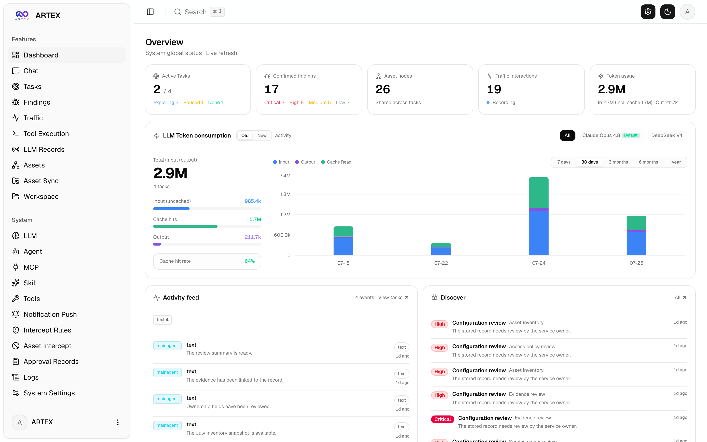 | 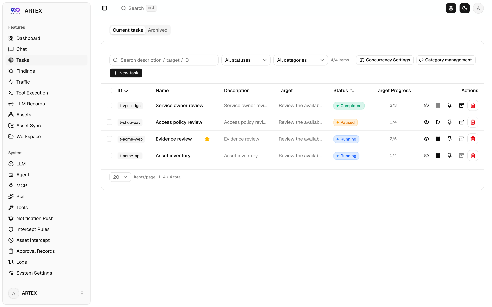 |

| Task · Execution process (sessions / tool calls) | Exploration graph |
| :---: | :---: |
| 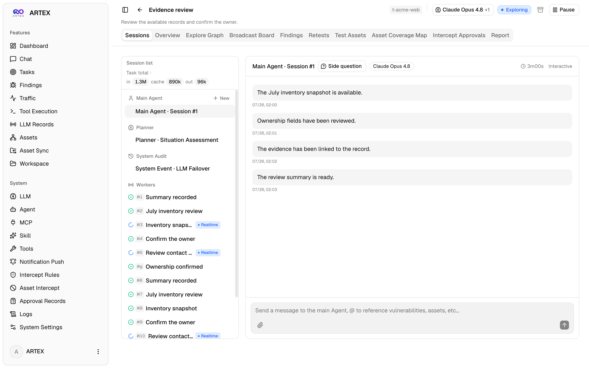 | 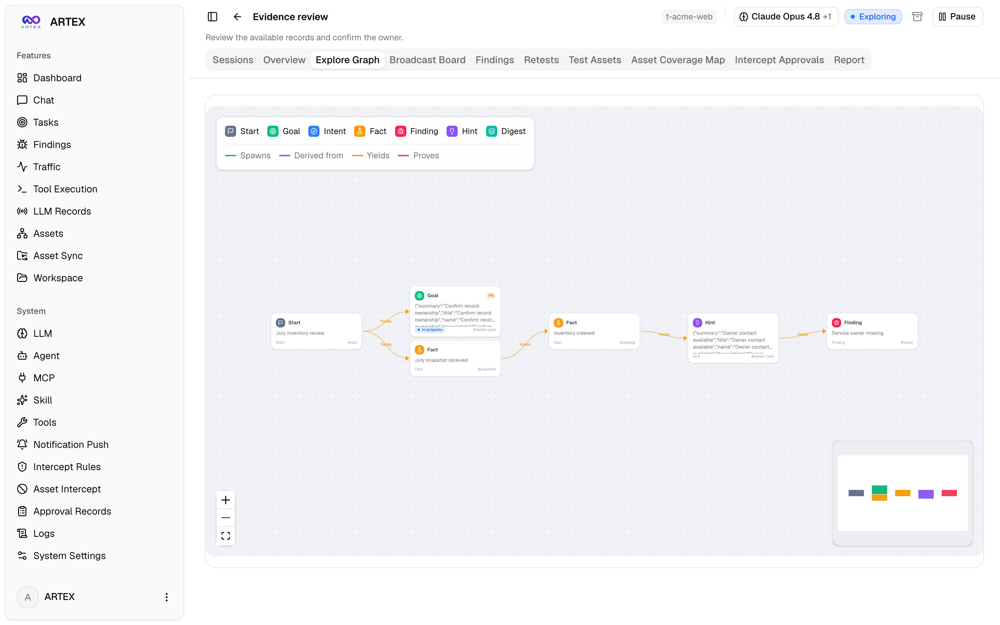 |

| Findings | Assets |
| :---: | :---: |
| 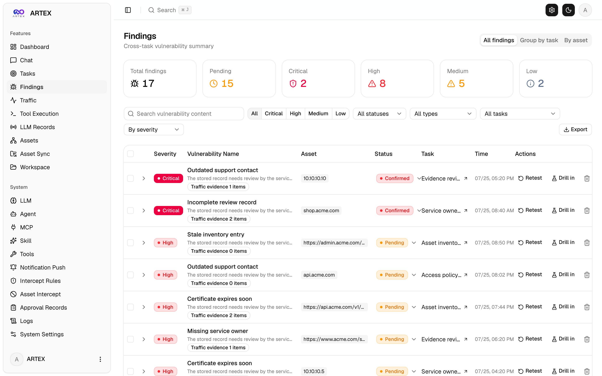 | 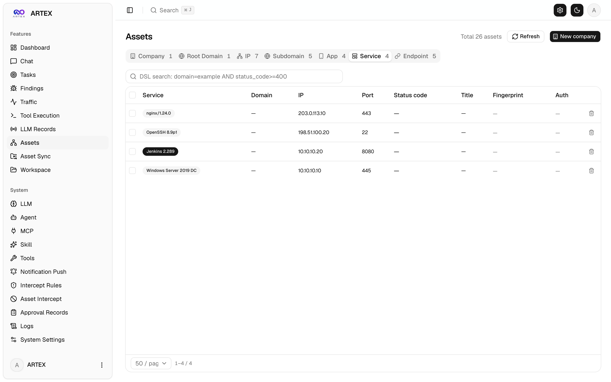 |

| Asset coverage graph (force-directed layout · tested highlighted · nodes collapse/expand) |
| :---: |
| 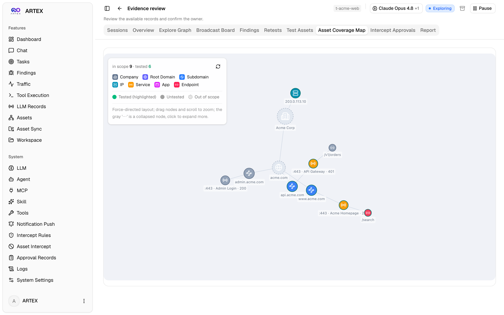 |

| Traffic recording | Human-in-the-loop conversation |
| :---: | :---: |
| 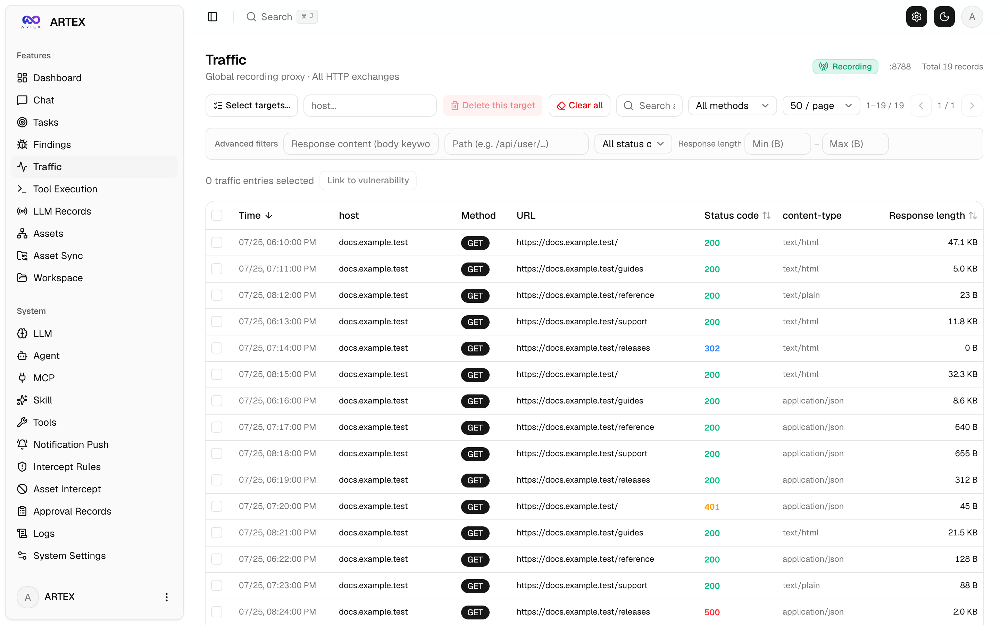 | 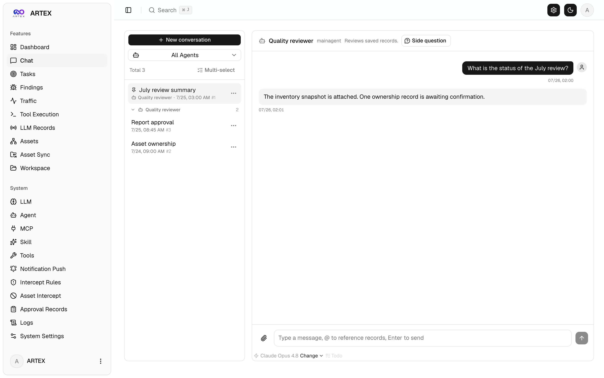 |

| Agent management | LLM configuration |
| :---: | :---: |
| 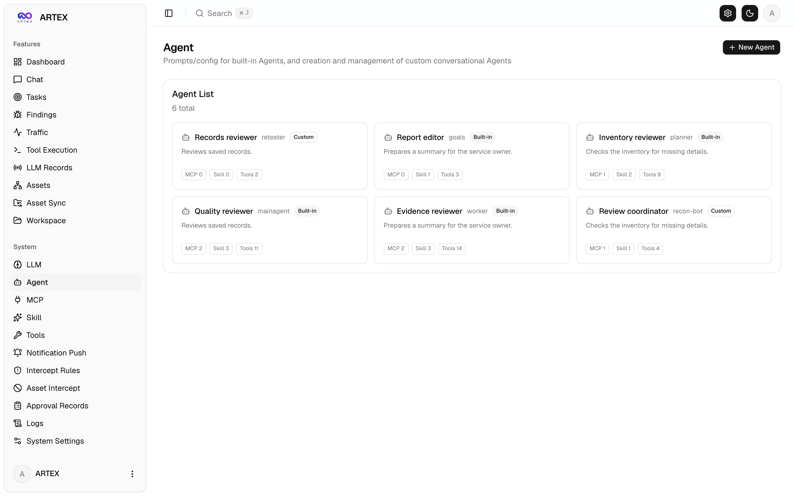 | 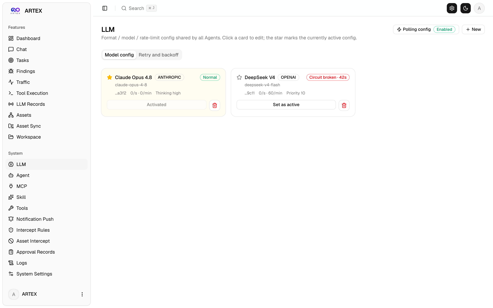 |

| Intercept approval | Backend logs |
| :---: | :---: |
| 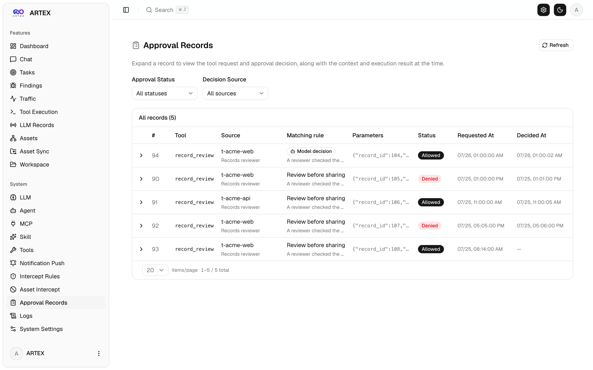 | 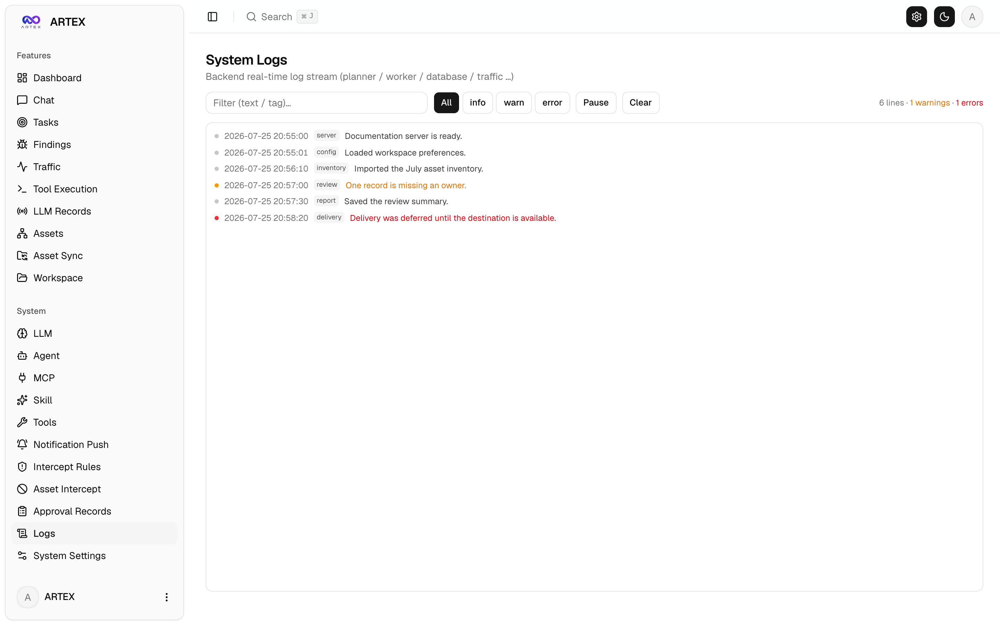 |


---

## Approval record details

The global 'Approval records', the in-task 'Intercept approval', and the approval cards in conversations all support expanding to view details. The display structure references
[AegisHook's approval detail component](https://github.com/RuoJi6/AegisHook/blob/main/web/src/components/CallDetail.vue), reusing ARTEX's components and theme:


## Asset sync (ScopeSentry)

Supports syncing asset data directly from [ScopeSentry](https://github.com/Autumn-27/ScopeSentry), eliminating the need for repeated collection:

- On the '**Asset sync**' page, fill in ScopeSentry's address and API Key to connect the data source;
- Select the targets and asset types to sync by **project** or **task** dimension (domain / subdomain / IP / port / site / endpoint…);
- One-click import and merge by company asset scope, going straight into ARTEX's asset graph for agent exploration.

---

## Installation

> Requires the **PostgreSQL** database; exploration needs an **LLM** configured (`ANTHROPIC_API_KEY` or `OPENAI_API_KEY`, or configure it in the UI).

### Option 1: One-click install script (recommended)

```bash
git clone https://github.com/Autumn-27/ARTEX.git
cd ARTEX
./install.sh
```

The script will: detect / auto-install Docker → let you choose **① All Docker** or **② Local build and run**:

- **① All Docker**: enter a Postgres password (press Enter for random) → auto-write `.env` → `docker compose up -d`.
- **② Local run**: choose a database (connect to existing / start one with Docker) → generate `config.json` → `go` compile the embedded single binary → start.

After installation, open **http://localhost:8787** (on first visit, go to `/setup` to set the admin password).

### Option 2: Docker Compose (manual)

```bash
git clone https://github.com/Autumn-27/ARTEX.git
cd ARTEX
cp .env.example .env          # fill in POSTGRES_PASSWORD, optionally ANTHROPIC_API_KEY
docker compose up -d          # pull the autumn27/artex image + postgres
# → http://localhost:8787
```

The image includes common tools (ripgrep/curl/vim/npm/nmap…); `./skills` and `./data` are persisted via bind mounts.

For remote MCP, you can choose `http` (Streamable HTTP) or `sse` (legacy SSE) in system settings.
Legacy SSE services typically use `GET /sse` to establish the event stream, then receive JSON-RPC requests via the
`/message?sessionId=...` returned by the service; when configuring, set the URL to `/sse` and fill in the request headers as
`Authorization=Bearer <token>`.

### Option 3: Download prebuilt binaries (Releases)

Go to [Releases](https://github.com/Autumn-27/ARTEX/releases) to download the zip for your platform; after extracting you get `artex` + `start.sh` (`start.bat` on Windows) + `skills/` + `config.example.json`:

```bash
cp config.example.json config.json   # fill in the database connection
./start.sh                           # → http://localhost:8787
```

 > Please start with `start.sh` / `start.bat` rather than running `./artex` directly. It is a supervisor script: after the program exits, it decides based on the exit code whether to restart it; **the [one-click update](#方式一页面一键更新推荐) on the page relies on it to swap in the new version**. If you run `./artex` directly, it won't be restarted after an update.
> Run in the background: `nohup ./start.sh >artex.log 2>&1 &`.

### Option 4: Compile a single binary from source

```bash
# 1) Frontend static export
cd web && npm ci && npm run build:static && cd ..
# 2) Copy into the embedded directory
cp -r web/out server/webui/dist
# 3) Compile (only -tags embedui embeds the frontend)
CGO_ENABLED=0 go build -tags embedui -o artex ./cmd/artex
./start.sh
```

### Option 5: Build cross-platform Release archives

`build.sh` first builds and embeds the frontend, then uses the Go linker to strip debug info and compresses the release files into a zip. Release mode by default generates zip packages for Linux amd64/arm64, macOS amd64/arm64, and Windows amd64:

```bash
./build.sh --release
# Output: dist/artex-0.3.3-*.zip
```

UPX self-extracting binaries may be incompatible with some Linux kernels, virtualization environments, or security policies, so they are disabled by default. You can customize targets with `ARTEX_TARGETS`; when you confirm the target runtime environment is compatible, you can explicitly pass `--upx` to further shrink the binary:

```bash
ARTEX_TARGETS=linux/amd64,windows/amd64 ./build.sh --release
./build.sh --target linux/amd64 --upx
```

---

## Updating and upgrading

> Upgrading only swaps the program, not the data: the Postgres data volume `pgdata`, `./data` (jwt.key / SQLite, etc.), and `./skills` are all preserved. **Database migrations require no manual execution**—`artex` idempotently re-runs `schema.sql` on every startup (including `ADD COLUMN` / `CREATE INDEX IF NOT EXISTS`), i.e. 'restart is migration'. Before upgrading, it is still recommended to back up `./data` and the database.

### Option 1: One-click update from the page (recommended)

In the **Version & Update** card on the **System Settings** page (sidebar 'System Settings' → `/system/settings`), you can directly check for and install new versions without logging into the server.

After clicking 'Update': download the release package for the current platform → compare against the Release's `SHA256SUMS` → smoke-test the new binary with `-h` → stage it as `artex.new` → the program exits, and `start.sh` / `start.bat` relaunches it and completes the swap. The page automatically waits until the new version comes online and then refreshes.

- **Failures won't leave a broken program**: if verification or smoke test fails, the staged file is discarded and the current version keeps running; if the new version after the swap fails to start 3 times in a row, it automatically rolls back to `artex.old` (the failed one is kept as `artex.failed` for troubleshooting).
- **Can roll back at any time**: the previous version is kept as `artex.old`, and the card has a 'Roll back to previous version' option. Note that the database schema will not roll back.
- **Updating interrupts running tasks**—updating means restarting, so do it when idle.
- **Dev builds don't offer updates**: disabled when the version number is `dev` or `git describe` has a suffix, to avoid a release version overwriting the locally debugged binary.
- **Under Docker, only the program is swapped, not the image**: toolchains like playwright / nmap in the image won't be upgraded along with it, and after `docker compose up -d` rebuilds the container it reverts to the version bundled in the image. To upgrade the image as well, still use `docker compose pull artex && docker compose up -d artex`.
- If accessing GitHub requires a proxy, just configure a **global proxy** on the same page, and the update path will use it. Updates only download from GitHub domains and enforce HTTPS.

### Option 2: One-click update script

```bash
cd ARTEX
./update.sh
```

The script first optionally runs `git pull` to fetch the latest code, then lets you choose **① Docker update** or **② Local build update** (corresponding to `install.sh`):

- **① Docker**: you can specify the target image tag (press Enter to use `ARTEX_TAG` from `.env`, defaulting to `latest`) → `docker compose pull` → `docker compose up -d` (swapping to the new image and restarting triggers automatic migration).
- **② Local**: rebuild the frontend static assets → recompile `./artex` (takes effect after restarting the process).

### Option 3: Docker Compose (manual)

```bash
cd ARTEX
git pull                       # Update compose / scripts (optional)
# Specify version: set ARTEX_TAG=v0.2.0 in .env; if unset, latest is used
docker compose pull artex
docker compose up -d artex     # Swap to new image and restart → auto-migrate schema
docker image prune -f          # Clean up old images (optional)
```

### Option 4: Prebuilt binaries (Releases)

Download the new version zip from [Releases](https://github.com/Autumn-27/ARTEX/releases), stop the old process, then overwrite `artex` and `skills/` (keeping your `config.json` and `data/`), and restart:

```bash
cp -r <extract-dir>/skills ./ && cp <extract-dir>/artex ./
./start.sh
```

### Option 5: Build from source

```bash
git pull
cd web && npm ci && npm run build:static && cd ..
cp -r web/out server/webui/dist
CGO_ENABLED=0 go build -tags embedui -o artex ./cmd/artex
# Restart ./start.sh
```

---

## Configuration

**Database** (`config.json`, or override with the environment variable `ARTEX_PG_DSN`):

```json
{
  "database": {
    "host": "127.0.0.1", "port": 5432,
    "user": "artex", "password": "yourpass",
    "dbname": "artex", "sslmode": "disable"
  }
}
```

**LLM**: `export ANTHROPIC_API_KEY=sk-...` (or `OPENAI_API_KEY`), or fill it in on the 'LLM Config' page in the UI.
Optional: `ARTEX_LLM_PROVIDER` / `ARTEX_LLM_MODEL` / `ARTEX_LLM_BASE_URL` / `ARTEX_LLM_PROXY`.

**Concurrency**: the number of work agents per task is configured in 'System Settings' (default 3).

**Common parameters**: `./start.sh -addr :8787 -proxy :8788` (`-addr` frontend+API, `-proxy` traffic recording proxy). The startup script passes the parameters through to `artex` as-is.

### Reverse proxy deployment (HTTPS / only expose 443)

The frontend and API/SSE are both served by the same backend port (default `:8787`), and the real-time activity stream uses a **same-origin** address by default, so **no `NEXT_PUBLIC_SSE_BASE` configuration is needed**; just expose only 443 publicly and keep 8787 on the internal network.

SSE is a long-lived connection with continuous push, so the reverse proxy **must disable buffering**; otherwise the browser can connect but receives no events (the activity stream keeps spinning). Nginx example:

```nginx
server {
    listen 443 ssl;
    server_name your.domain.com;
    # ssl_certificate / ssl_certificate_key ...

    location / {
        proxy_pass http://127.0.0.1:8787;
        proxy_set_header Host $host;
        proxy_set_header X-Forwarded-Proto $scheme;

        # SSE key items: disable buffering, long timeout, HTTP/1.1
        proxy_buffering off;
        proxy_cache off;
        proxy_read_timeout 3600s;
        proxy_http_version 1.1;
        proxy_set_header Connection "";
    }
}
```

> Only when SSE needs to come from a different origin than the page (e.g. a separate subdomain) should you set `NEXT_PUBLIC_SSE_BASE` at **build time** (this variable is baked into the static bundle during `next build`; setting it at container runtime has no effect).

---


## Development

### Manual vulnerability retest

The 'Retest' tab in the task details lets you page through the vulnerabilities of this task, view past conclusions and evidence, and manually start a retest. After starting, the current tab is kept, showing a spinner icon and 'Retesting'; once the fix is confirmed, the vulnerability status is updated accordingly.

Click 'Retest' in the action area of each row in the vulnerability list, or click 'Start Retest' in the 'Vulnerability Retest' section of the vulnerability details, and fill in the optional fixed version, test conditions, or limitations; the system creates a separate retest Agent session and keeps the current page after starting. This entry point is supported in the flat list, grouped-by-task, and asset views; while a retest is running, a spinner icon and 'Retesting' are shown; click to enter the corresponding session when you need to check it, and it returns to 'Retest' when finished. A retest does not require restarting the original scan task; conclusions are 'Still Reproducible', 'Fixed', or 'Unable to Confirm', and each conclusion, evidence, and session link is saved in the vulnerability details.

On first startup, the new backend provisions an editable 'Vulnerability Retest' (`retester`) Agent, whose prompt, LLM, run budget, and tools can be configured in Agent Management. It uses its bound LLM by default, or the globally active configuration if none is bound. When a retest session completes successfully with the conclusion 'Fixed', the system automatically changes the vulnerability disposition status to 'Fixed'; in-progress, failed, stopped, or other conclusions keep the original status. The original evidence and report are always retained. You can also manually select 'Fixed' from the status dropdown. If the same vulnerability is already being retested, the existing session is reused; after stopping, failing, or a service restart, you can start it again.

In this version, history is viewed through vulnerability details and sessions; it is not yet included in vulnerability report exports or task archive packages, nor automatically linked to traffic captures. Demo mode only generates clearly labeled simulated records and does not request real targets.

### Local run and test

```bash
./dev.sh    # backend(:8787) + traffic proxy(:8788) + frontend next dev(:5173) → http://localhost:5173
```

- Backend: `go run ./cmd/artex` (without `-tags embedui`, the frontend is not embedded)
- Frontend: `cd web && npm run dev` (`/api` is reverse-proxied to the backend, with hot reload)
- Test: `go test ./...`
- Mock preview (no backend): `cd web && NEXT_PUBLIC_MOCK=1 npm run dev`

---

## System Technical Architecture

ARTEX is an **LLM multi-agent driven autonomous penetration system**: a Go monolith backend (with embedded Next.js frontend) + PostgreSQL, with agent capabilities provided by the [`norma`](https://github.com/Autumn-27/norma) SDK (`agentcore` / `tool` / `permission` / `harness` / `memory` / `transcript`). At its core is a **dual-graph architecture**, along with two autonomy mechanisms built around it: **process-level information exchange between workers** and **planner multi-round shared todolist stable attack chain**.

### Overall Layering

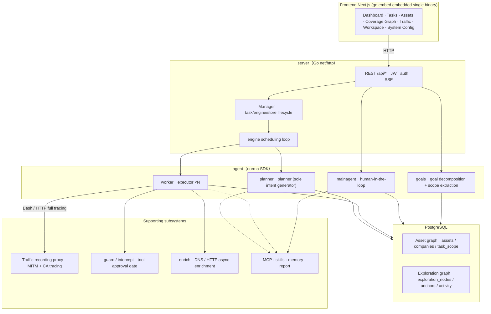

| Layer | Responsibility |
| --- | --- |
| **Frontend** | Next.js static export, `go:embed` embedded into single binary; visualize tasks/assets/exploration chain/coverage graph, human-in-the-loop dialogue |
| **server** | `net/http` routing + JWT auth + SSE; `Manager` manages the lifecycle of tasks, engines, and DB stores |
| **engine** | One `plannerLoop` + N worker goroutines per task; intent claiming, timeout/pause/drain |
| **agent** | goals / planner / worker / mainagent; `ToolSet` exposes the dual graphs as LLM tools |
| **db** | Postgres persistence for the dual graphs (pgx); schema is idempotently created on every startup via `go:embed` |
| **support** | Recording MITM proxy, approval gate, async completion, MCP/skills/memory/reports |

### Dual-graph architecture: exploration graph + asset graph

The system splits '**what the goal is**' and '**how far testing has progressed**' into two independent graphs connected by anchors:

- **Asset Graph (globally shared)**: a single source-of-truth asset store shared across tasks. Nodes are `root_domain / subdomain / ip / service / app / endpoint`, owned by a company; the parent-child relationships domain→subdomain→service→endpoint and dedup keys are all computed by the program, and agents only submit raw information.
- **Exploration Graph (per-task, independent)**: the 'thinking and progression' process of a single task. Nodes are `goal / intent / fact / finding / hint`, connected by edges like `spawns / derived_from / yields / proves` into a **lineage chain**, answering 'which direction was derived from which facts, and what did it produce'.
- **The two graphs are connected by anchors**: `exploration_anchors(node_id, asset_id)` anchors intents/facts/findings to specific assets—so you can both see which assets an 'exploration direction' targets, and reverse-look-up from 'a given asset' which intents tested it in this task and which facts were derived. This also supports **asset test coverage** and the **asset coverage map** (in-scope assets + tested highlighted).

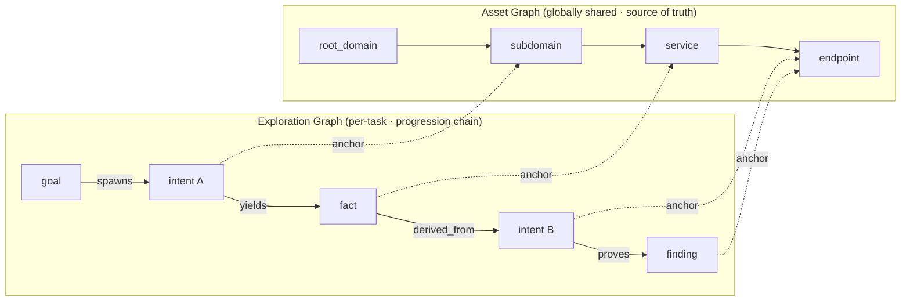

> Division of labor: **planner** reads the exploration graph situation, judges the goal, and only dispatches **intents** to the frontier when there are uncovered new directions; **worker** takes **one intent**, executes with real tools, writes new assets/facts/findings back to both graphs, then stops. The asset graph is shared facts; the exploration graph is the per-task progression chain.

### Engine and intent lifecycle (the closed loop of one exploration)

The engine is an **event-driven** closed loop: any graph change wakes the planner, the planner dispatches intents, workers take intents, execute, and write back, and the write-back triggers the next round—until the goal is proven (`prove_goal`).

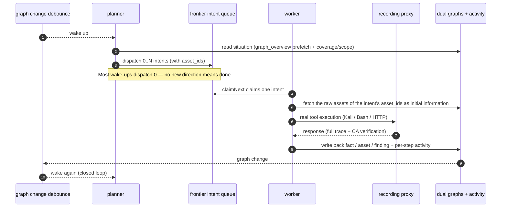

### Process-level information exchange between workers

In a deep exploration, many valuable observations (some error, some response, some hidden parameter) appear in a worker's **execution process**, yet are not necessarily written up as formal facts. To avoid duplicated effort and let workers along the chain stand on each other's shoulders, workers have the ability to **search processes across works**:

- `search_all_worker_traces(q)`: keyword-search the **execution processes of other works in this task** (automatically excluding the steps of one's own intent); hits carry an `intent_id`;
- `list_worker_traces` / `get_worker_trace(intent_id, step_ids=[…])`: first see which works have run, then fetch the full content of specific steps of a given work for detailed exchange.

This way, even if the exploration graph has no corresponding fact yet, later workers can reuse observations from others' processes — **information flows between workers at the granularity of 'execution process'**, while the boundary stays the same (each worker still only does the one intent it claimed).

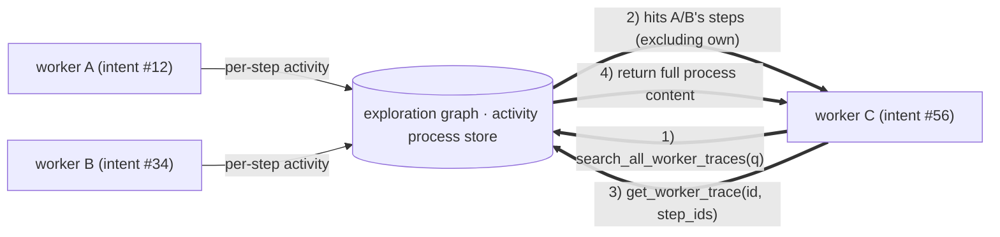

### planner shares todolist across rounds → stable attack chain

A real attack chain is often a **multi-step sequence with dependencies** (e.g., find injection point → obtain credentials → lateral movement → privilege escalation); dispatching all of these in parallel at once only causes chaos. The planner therefore keeps a **planning todo list (todolist) retained per task and shared across wake-ups**:

- the planner is event-driven — it is woken whenever the graph changes, but **each wake-up is a brand-new session**; the shared todolist lets it **record a serial exploitation chain once**, then **dispatch intents step by step according to dependencies** over subsequent rounds, instead of front-loading the whole chain in one round;
- each round it only dispatches intents for the next step whose 'prerequisite steps are complete and whose dependent facts exist', and updates the list as progress is made (marking steps already satisfied by facts as complete).

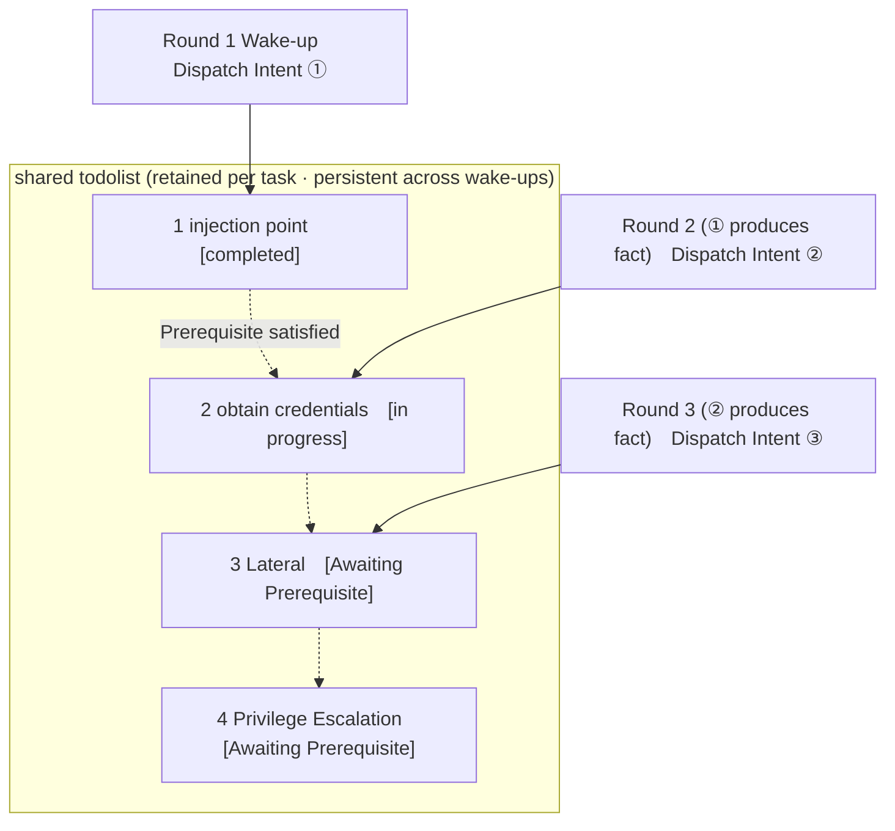

Thus, in an environment of 'event-driven + stateless sessions', the attack chain still **advances steadily, without repetition or out-of-order steps**—this is the key to ARTEX being able to autonomously complete a multi-step exploitation chain.

---

## Community Group

Scan the QR code to follow the WeChat official account **SecSentry**, and send a private message via the official account backend to join the group for discussion.

<div align="center">


</div>

---
## References

https://github.com/oritera/Cairn


## License and Disclaimer

### Open Source License

This project is licensed under the **GNU Affero General Public License v3.0 (AGPL-3.0)**; see the [LICENSE](LICENSE) file in the repository root for the full terms.

This means anyone is free to use, modify, and distribute this project, but **derivative works must also be open-sourced under AGPL-3.0**; in particular, **if you modify this project and provide it to users over a network (e.g., deployed as an online service), you must also disclose the corresponding complete source code to those users**.

> ⚠️ **Important Notice**: The open source license itself does not restrict the purposes for which the software may be used. The following 'Usage Restrictions' and 'Disclaimer' are the author's additional agreements and solemn statements to users, and must be observed.

**ARTEX is intended only for personal learning, code research, and local technical verification, and must not be used to conduct actual testing against any online system or website.**

### Permitted Scope of Use

- May be used only for **reading, learning, and researching the source code of this project**, and for verifying technical principles in a **local isolated environment**;
- Suitable for non-offensive purposes such as personal learning, academic research, and code review.

### Prohibitions

- **It is strictly prohibited to use this tool to initiate scanning, probing, exploitation, or attacks against any website, online service, or networked system** (regardless of whether authorization is obtained or whether it is your own asset);
- It is strictly prohibited to use this tool for any actual penetration testing, offensive/defensive exercises, or production environments;
- It is strictly prohibited to use this tool for illegal intrusion, data theft, extortion, denial of service, or any destructive or criminal activity;
- It is strictly prohibited to use this tool to engage in conduct that violates the laws and regulations of your country/region.

### Compliance Responsibility

Users must comply with all laws and regulations of their country/region regarding network security, data protection, and computer crime (in mainland China, including but not limited to the 'Cybersecurity Law', 'Data Security Law', 'Personal Information Protection Law', and related judicial interpretations). **All legal responsibilities and consequences arising from the use of this tool shall be borne solely by the user.**

### Disclaimer

This project is provided 'AS IS', without any express or implied warranties. The author and contributors are not liable for any direct or indirect losses, data loss, system damage, or legal disputes caused by the use of this tool (whether used properly or not). **Downloading, installing, or using this project indicates that you have read, understood, and agreed to all the above terms.**
