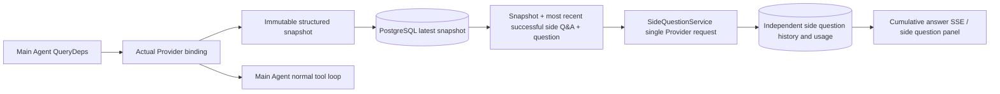

# ARTEX `/btw`

Regular chat, task MainAgent, and the current task's own Worker support independent side questions. Enter `/btw question` in the main input box to submit; an empty `/btw` or the 'Side Question' button opens history. Desktop uses a resizable sidebar, mobile uses a Drawer.

Side answers are generated from the Agent context snapshot at submission time, supporting streaming display, follow-ups, stop, and clear. Closing the panel, refreshing the page, or disconnecting SSE does not cancel the model request. Stop only affects the current side question; clear cancels the side question and deletes side question history while preserving the main context snapshot.

## Implementation Boundaries

Reuses Go, norma v0.3.7, Next.js, and the existing Markdown / ResizablePanel / Drawer / AlertDialog components; no norma source code was modified and no dependencies were added for side questions. Planner, Workers inherited from other tasks, and tool-type subtask upgrades are out of scope for this iteration.

- `capture.go` only marks main loop requests at `Options.Deps.CallModel / CallModelSync`. The Provider decorator sits inside the concrete model, after the routing pool's outer selection, so it records the actually selected model; compaction and summary requests do not overwrite the snapshot.
- Snapshots are published at request start, on complete model replies, and at run terminal states. In-progress partial replies are not published; tool calls stay paired via norma's `MessagesForAPI`, and tool results enter the snapshot on the next main model request or run terminal state. Streaming aborts preserve the last valid boundary.
- Snapshots preserve structured messages, system prompts, tool definitions, and generation parameters via JSON deep copy. Model inference holds no snapshot lock or database transaction.
- `SideQuestionService` calls the concrete Provider; if necessary it first generates a side question summary, and the final answer is allowed a single reduced retry only on the first context overflow when no text/tool call has been output yet. It creates no agent session, does not connect to the tool executor, main transcript, activity stream, or task graph, and does not go through the task model switching chain. Answers retain tool definitions for compatibility with existing structured tool contexts; summary requests provide no tools. Newly returned tool calls have no execution path.
- One running request per parent session, at most four per service process, 120-second timeout per request. Side questions use an independent cancellation context under the service lifecycle.
- Side question requests retain the model config reference and a non-sensitive identity summary; credentials are obtained from the existing config at request time. If the config is deleted, or identity fields such as model, protocol, or address change, the main Agent must be run first to update the snapshot. Tests do not change the product default model.

## Persistence and Recovery

`db/schema.sql` automatically creates `side_question_sessions` and `side_question_requests`. The former stores the parent resource, latest snapshot, run number, version, and cleanup version; the latter stores the question, cumulative answer, status, model, snapshot time, usage, event sequence number, and pagination sequence number.

The parent session key uses the conversation ID, or task ID + exploration ID + intent ID. Workers do not use reusable execution slot naming.

Snapshots are merged and written per parent session, refreshed every 250 ms, and the database compares `(run_id, version)` to prevent older versions from overwriting. The selected snapshot is saved again before side question submission. After a successful save, the large in-memory snapshot is released; on failure the pending version is retained. Cumulative answer content is written at most every 250 ms as streaming events arrive, and terminal states are saved immediately with limited retries on database errors.

On service startup, leftover `running` requests are marked `interrupted`, preserving the partially persisted answer and usage, without automatically replaying requests. The most recently successfully saved context can be used directly for the next question. If an old session has no snapshot, the main Agent must be run first; context is not rebuilt from UI activity records.

The clear operation increments the cleanup version and deletes requests; conditional updates prevent late callbacks from writing back. Physical parent resource deletion relies on foreign key cascades; Worker logical deletion deletes side question data in the same transaction and rejects subsequent late snapshots. Task archiving first blocks new requests, waits for the main flow to stop, cancels and waits for side questions to persist; the archive format is v3, while remaining compatible with v1/v2 that lack side question tables.

History is fully preserved, returning at most 20 entries per page by sequence cursor. Model requests replay at most the most recent 20 successful Q&A pairs verbatim, while limiting replay volume by token budget; older Q&A pairs maintain an independent rolling summary. When the main context exceeds budget, only the older portion of the side question copy is summarized, preserving recent structured tool calls and results. Summaries, preparation progress, and usage are all included in the side question's concurrency, cancellation, and 120-second timeout limits. See [Context Budget and Open Source References](CONTEXT_BUDGET.md).

## HTTP Contract

The following path serves as `{parent}`, reusing existing authentication and resource validation:

- `/api/conversations/{id}`
- `/api/tasks/{id}/chat`
- `/api/tasks/{id}/intents/{iid}`

| Request | Response and behavior |
| --- | --- |
| `GET {parent}/side-questions?before={ordinal}` | `items` ordered newest to oldest, independent `current` run status, `snapshot` metadata, `next_cursor`; a cursor of 0 means the latest page / no next page |
| `POST {parent}/side-questions` | JSON `{ "question": "…", "client_request_id": "UUID" }`; a new request returns 202 and the request object; the same ID and question returns the existing object with 200 |
| `DELETE {parent}/side-questions` | Cancel and clear the side questions of the current parent session |
| `GET /api/side-questions/{requestID}/events` | `snapshot` SSE event, `id` is an incrementing sequence number, `data` is the full cumulative request object; sends `cleared` when cleared |
| `POST /api/side-questions/{requestID}/cancel` | Explicit cancel; terminal state can be read from history or SSE |

Question limit is 4000 characters. Returns 409 when there is no snapshot, the model configuration changed, the same parent session is busy, or the idempotency ID conflicts; returns 429 when the global concurrency limit is reached. Each SSE connection first sends the cumulative state and does not depend on text fragments the client previously received. The frontend merges by request ID + sequence number, and discards old callbacks when switching parent sessions or clearing.

## Validation and References

See [VALIDATION.md](VALIDATION.md) for automated checks, actual model usage, and known limitations.

For the standalone request, see [Grok CLI side-question.ts (pinned commit)](https://github.com/superagent-ai/grok-cli/blob/fb97af83f06dca873281d60168430f06c8de6324/src/utils/side-question.ts); for run isolation, see [OpenCode (pinned commit)](https://github.com/anomalyco/opencode/tree/b3f1a96c6dd7adeb28b36dd11add1998fc84d67b). ARTEX's context uses norma's structured messages, rather than concatenating text from frontend logs.
