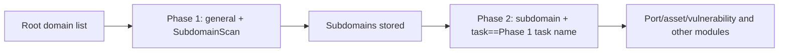

---

## name: scopesentry-mcp
description: Manage the security scanning platform (projects, tasks, templates, assets, nodes) via ScopeSentry MCP. Use when the user mentions ScopeSentry, MCP, API Key, scan tasks, or asset queries.

# ScopeSentry MCP Usage Guide

For users with a **deployed ScopeSentry instance**. Connect to the platform via Cursor (or another MCP client), no local source code needed.

## 1. Preparation

### 1.1 Confirm the service is accessible

- Default Web interface: `http://<host>`
- MCP endpoint: `http://<host>/mcp` (if there is a reverse proxy or frontend proxy in front, use the actual `/mcp` address)

### 1.2 Create an API Key

1. Log in to the ScopeSentry Web interface in a browser
2. Go to the **API Key** management page to create a key (or create one via the interface provided by the administrator)
3. Save the returned `ssk_...` string (**shown only once**)

### 1.3 Configure Cursor MCP

Cursor → Settings → MCP → Add server:

```json
{
  "mcpServers": {
    "scopesentry": {
      "url": "http://<your host>:8082/mcp",
      "headers": {
        "X-API-Key": "ssk_your key"
      }
    }
  }
}
```

You can also use: `Authorization: Bearer ssk_your key`

After configuration, restart MCP or reload Cursor, and confirm that `list_projects`, `list_assets`, etc. appear in the tool list.

---

## 2. Tool Overview


| Tool                     | Purpose                |
| ---------------------- | ----------------- |
| `list_projects`        | Project tree grouped by tag (including project IDs) |
| `list_projects_data`   | Paginated project list, searchable by name     |
| `get_project`          | Project details              |
| `create_project`       | Create a new project              |
| `list_tasks`           | Scan task list            |
| `get_task`             | Task details              |
| `list_scan_templates`  | Scan template list            |
| `get_scan_template`    | Template details              |
| `list_plugin_modules`  | Scan pipeline module names          |
| `list_plugins`         | Available plugins (including hash, default parameters) |
| `create_scan_template` | Create scan template            |
| `create_scan_task`     | Create scan task            |
| `list_assets`          | Query various assets (paginated list)       |
| `count_assets`         | Count assets (`/api/assets/common/total`) |
| `get_asset_detail`     | Asset or vulnerability details           |
| `add_asset_tag`        | Add tags to assets           |
| `list_nodes`           | Scan node list            |


Tool parameters are subject to the MCP tool description (schema); the search and filter syntax of `list_assets` / `count_assets` are the same. Before querying assets, you can first read the `list_assets` description.

When you need to know 'how many records in total', use `count_assets` (corresponding to the Web pagination total count API); there is no need to repeatedly page through `list_assets` just to count the total.

---

## 3. Common Workflows

### 3.1 Query assets by project

When the user or context **already has a project condition**, prioritize including `filter.project` to narrow the scope, avoiding too much cross-project data causing slow responses. If there is no clear project, adding a project filter is not mandatory.

1. `list_projects` or `list_projects_data` to get the target project's **ObjectID** (`id` / `children[].value`)
2. Pass `filter.project` to `list_assets` (**must be an ID, cannot use the project's Chinese name**)

```json
{
  "asset_type": "asset",
  "pageIndex": 1,
  "pageSize": 20,
  "search": "domain=^example.com",
  "filter": {
    "project": ["<project ObjectID>"]
  }
}
```

### 3.2 Create scan task

1. `list_nodes` to get online node names
2. `list_scan_templates` or `create_scan_template` to get the template **ObjectID**
3. `create_scan_task`: `name` and `node` are required; `template` should be filled with the template ID (cannot use the template name)

**Target source `targetSource` (consistent with the Web side):**

| targetSource | Description | Required parameters |
| --- | --- | --- |
| `general` | Enter the target directly | `target` |
| `project` | Read targets from a project | `project` (array of project ObjectIDs) |
| `asset` | Search from the Web asset library | `search`; optional `project`, `filter`, `targetNumber` |
| `RootDomain` | Search from the root domain library | `search`; optional `project`, `filter`, `targetNumber` |
| `subdomain` | Search from the subdomain library | `search`; optional `project`, `filter`, `targetNumber` |
| `UrlScan` | Search from URL scan results | `search`; optional `project`, `filter`, `targetNumber` |
| `*Source` (e.g. `subdomainSource`) | Create from the asset page 'select/search' | use `search` when `targetTp=search`; use `targetIds` when `targetTp=select` |

**Example — scan root domains directly:**

```json
{
  "name": "example-subdomain-collection",
  "node": ["node-1"],
  "template": "<template ObjectID>",
  "targetSource": "general",
  "target": "example.com\nfoo.com",
  "project": ["<project ObjectID>"]
}
```

**Example — continue scanning from the subdomain library (filter by previous task name):**

```json
{
  "name": "example-ports-and-vulnerabilities",
  "node": ["node-1"],
  "template": "<follow-up module template ObjectID>",
  "targetSource": "subdomain",
  "search": "task==\"example-subdomain-collection\"",
  "project": ["<project ObjectID>"]
}
```

### 3.3 Full information gathering for root domains (two phases recommended)

When the input is a **root domain** and you want to perform **full information gathering**, it is recommended to scan in two passes rather than running the entire pipeline at once.

**Reason:** Distributed tasks are dispatched per **single target**. When a root domain is the target, after a node is assigned that root domain, the subdomains discovered on that node will also continue to run subsequent modules on that node, which easily causes uneven load, slow speed, and errors.

**Best practice:**

1. **Phase one — subdomain collection only**
   - `targetSource`: `general`
   - `target`: all root domains (multiple lines)
   - Template: enable only `SubdomainScan`, `SubdomainSecurity` (subdomain scan + subdomain takeover)
   - Use `get_task` to wait for the task to complete

2. **Phase two — subsequent modules**
   - `targetSource`: `subdomain`
   - `search`: `task=="<Phase 1 task name>"` (exact match on task name)
   - Optional `project` to narrow the scope
   - Templates: port scan, asset mapping, vulnerability scan, etc. (SubdomainScan may be omitted)
   - Subdomains are distributed to each node as independent targets, giving higher parallel efficiency

You can also filter by task name on the 'Subdomains' asset page in the Web UI, then use 'Create Task from Subdomains' for the same effect.



### 3.4 Create a scan template

1. `list_plugin_modules` → list of module names
2. `list_plugins` (can be filtered by `module`) → each plugin's `hash` and default `parameter`
3. `create_scan_template`: use `modules` to specify 'module → array of plugin hashes'

---

## 4. Asset queries (`list_assets` / `count_assets`)

`count_assets` uses the same `asset_type`, `search`, and `filter` as `list_assets`, and returns `{ "total": N }`, corresponding to the Web-side `/api/assets/common/total`.

```json
{
  "asset_type": "subdomain",
  "search": "task==\"some task name\"",
  "filter": {"project": ["<project ObjectID>"]}
}
```

**Performance tips (apply to both `list_assets` / `count_assets`):** When a project condition is present, prefer `filter.project` to narrow the scope; in `search`, for indexed fields use `==` exact match or `^` prefix match where possible (see [4.3](#43-search-搜索表达式)), to avoid large-scale `=` fuzzy queries slowing down responses. When there is no project context, adding a project filter is not required.

For the types that support `filter.project`, see the table in [4.4](#44-filter-精确过滤).

### 4.1 Asset type `asset_type`

`asset`、`RootDomain`、`subdomain`、`app`、`mp`、`UrlScan`、`SensitiveResult`、`DirScanResult`、`crawler`、`vulnerability`、`PageMonitoring`、`IPAsset`、`SubdomainTakerResult`

Alias examples: `web`→asset, `vuln`→vulnerability, `ip`→IPAsset, `url`→UrlScan

### 4.2 Parameter description


| Parameter                 | Description                               |
| ------------------------ | --------------------------------------- |
| `pageIndex` / `pageSize` | Pagination, default 1 / 20               |
| `search`                 | Search expression (see next section)      |
| `filter`                 | Exact JSON filtering (see next section)                          |
| `sort`                   | Only UrlScan and DirScanResult support sorting by `length` |
| `sid`                    | Only SensitiveResult: sensitive rule name                |


`search` and `filter` **can be used together**.

### 4.3 search search expression

Custom DSL (**not SQL**):


| Operator  | Meaning   | Index | Example                          |
| ---- | ---- | ---- | --------------------------- |
| `=`  | Fuzzy match (regex) | No index | `domain=example`            |
| `==` | Exact match (full equality) | **Uses index** | `port==443`                 |
| `!=` | Exclude   | — | `port!="80"`                |
| `&&` | AND    | — | `domain==example.com && port==443` |
| `||` | OR    | — | `title=admin || body=login` |


**Indexes and operators:** Fields such as `domain`, `ip`, `port`, and `title` are indexed, but only **`==` full equality** or **prefix matching where the value starts with `^`** (e.g. `domain=^example.com`) can use the index; **`=` is converted to regex fuzzy matching and cannot use the index**, so it tends to slow down with large data volumes.

**search fields common to all types:** `tag`, `task` (task name), `rootDomain`

**project cannot be written in search** (invalid, or errors when combined with `&&`). To filter by project, use `filter.project`.

**Common search fields by type:**


| asset_type           | Fields                                                                                  |
| -------------------- | ----------------------------------------------------------------------------------- |
| asset                | domain, ip, port, service, app, title, statuscode, icon, banner, type, body, header |
| RootDomain           | domain, icp, company                                                                |
| subdomain            | domain, ip, type, value                                                             |
| app                  | name, icp, company, category, description, url, apk                                 |
| mp                   | name, icp, company, category, description, url                                      |
| UrlScan              | url, input, source, resultId, type                                                  |
| SensitiveResult      | url, sname, body, info, md5                                                         |
| DirScanResult        | url, statuscode, redirect, length                                                   |
| vulnerability        | url, vulname, matched, request, response, level                                     |
| crawler              | url, method, body, resultId                                                         |
| PageMonitoring       | url, hash, diff, response                                                           |
| IPAsset              | ip, domain, port, service, webServer, app                                           |
| SubdomainTakerResult | domain, value, type, response                                                       |


**search examples:**

- `domain==www.example.com && port==443` (full equality, uses index)
- `domain=^example.com` (prefix match, uses index)
- `ip==192.168.1.1`
- `task=="some task name"`
- `level==high`（vulnerability）
- `statuscode==200`（DirScanResult）

When fuzzy containment is needed, use `=` instead, e.g. `title=admin` (no index, best combined with conditions like project to narrow the scope).

### 4.4 filter exact filtering

JSON object: multiple values for the same key are **OR**, different keys are **AND**.

**Prefer `project` when a project condition exists:** If the user or context already specifies a project, and asset_type supports `project`, include it to narrow the scope; it is not mandatory when there is no project information.


| filter key   | Meaning       | Value description                                                     |
| ------------ | -------- | -------------------------------------------------------- |
| `project`    | Owning project     | **ObjectID**, obtain with `list_projects` / `list_projects_data` |
| `task`       | Source task     | **Task name**, use `name` from `list_tasks`                         |
| `port`       | Port       | e.g. `"443"`                                                |
| `service`    | Service/Protocol    | e.g. `"https"`                                              |
| `app`        | Application fingerprint     | e.g. `"Nginx"`                                              |
| `icon`       | Icon hash  |                                                          |
| `statuscode` | HTTP status code | Mainly used for asset                                               |
| `status`     | Status       | UrlScan/DirScan HTTP code; vulnerability/sensitive info processing status                       |
| `level`      | Vulnerability level     | critical / high / medium / low / info                    |
| `type`       | Type       | e.g. subdomain record type A, CNAME                                         |
| `color`      | Sensitive rule color   | SensitiveResult                                          |
| `sname`      | Sensitive rule name    | SensitiveResult                                          |
| `tags`       | Tags       |                                                          |


**Available filter keys per type:**


| asset_type                            | filter key                                                      |
| ------------------------------------- | --------------------------------------------------------------- |
| asset                                 | project, port, service, app, icon, statuscode, type, task, tags |
| RootDomain                            | project, tags                                                   |
| subdomain                             | project, type, task, tags                                       |
| app / mp                              | project, tags                                                   |
| UrlScan                               | status, tags                                                    |
| DirScanResult                         | status, tags                                                    |
| SensitiveResult                       | status, color, sname, tags                                      |
| crawler                               | project, task, tags                                             |
| vulnerability                         | project, level, status, task, tags                              |
| PageMonitoring / SubdomainTakerResult | tags                                                            |
| IPAsset                               | project, port, service, app                                     |


**filter examples:**

```json
{"project": ["<project ObjectID>"], "port": ["443"]}
```

**Combined query example:**

```json
{
  "asset_type": "asset",
  "search": "domain=^baidu && port==443",
  "filter": {"project": ["<project ObjectID>"]},
  "pageIndex": 1,
  "pageSize": 10
}
```

**Notes:**

- When a project condition exists, prefer including `filter.project` (when supported); without project context it is not mandatory
- Do not put the project display name in `filter.project`
- Use `==` for known values, `^` for prefixes; avoid abusing `=` fuzzy matching on large tables
- For UrlScan HTTP status use `filter.status`; for DirScanResult you can use `statuscode==200` in search
- For SensitiveResult by rule name: use `sname=rule name` in `search`, or `filter.sname`

### 4.5 Sorting sort

Only **UrlScan** and **DirScanResult** support this:

```json
{"length": "ascending"}
```

Other types ignore `sort` and default to sorting by time.

---

## 5. Scan Template Module Names

`TargetHandler`、`SubdomainScan`、`SubdomainSecurity`、`PortScanPreparation`、`PortScan`、`PortFingerprint`、`AssetMapping`、`AssetHandle`、`URLScan`、`WebCrawler`、`URLSecurity`、`DirScan`、`VulnerabilityScan`、`PassiveScan`

---

## 6. Troubleshooting


| Symptom        | Resolution                                                 |
| --------- | -------------------------------------------------- |
| MCP has no tools   | Check the URL, API Key, and whether ScopeSentry is running                    |
| 401 / 403 | Recreate or replace the API Key                                    |
| Assets not found     | Confirm `filter.project` is an ObjectID; do not write project in search |
| Template/task creation failed | `template` must be a template ObjectID; `node` must be an online node name            |
| Queries are slow/stuck   | Add `filter.project` when a project exists; for indexed fields in search, use `==` or `^` prefix instead of `=`, and reduce `pageSize` |


---

